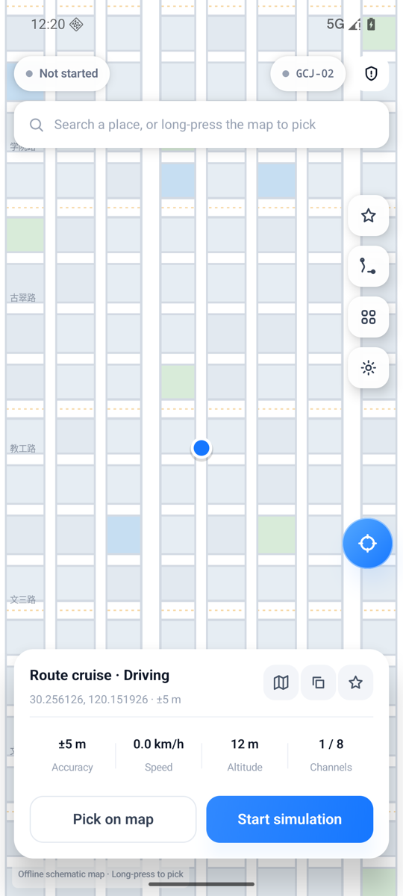
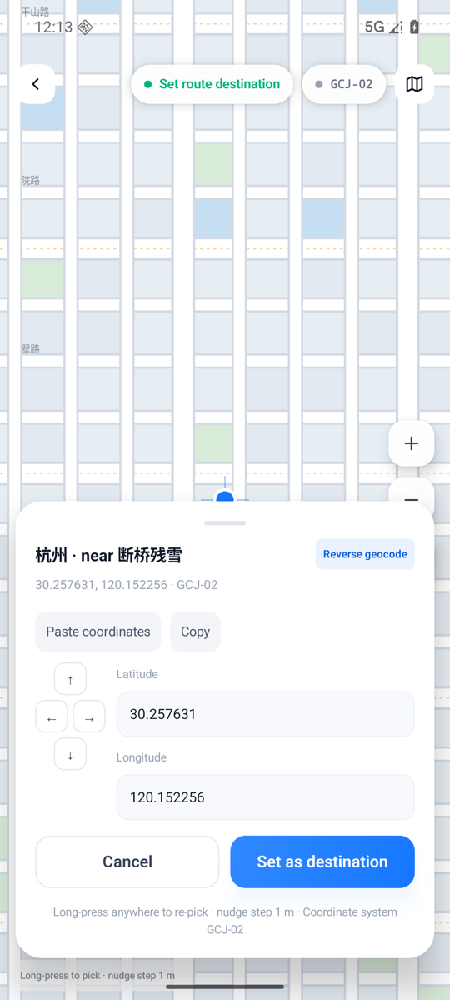
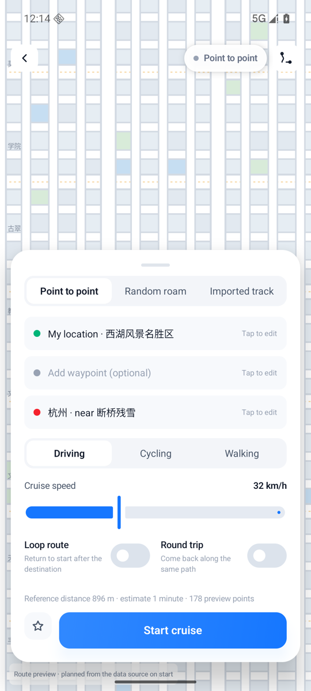
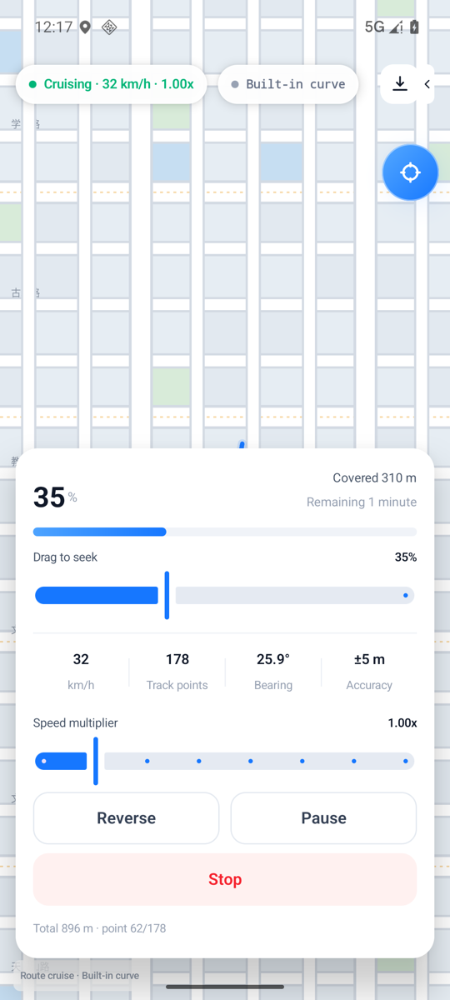
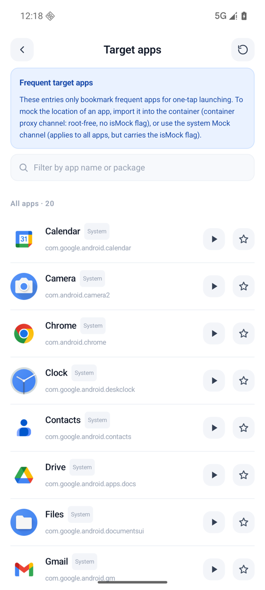
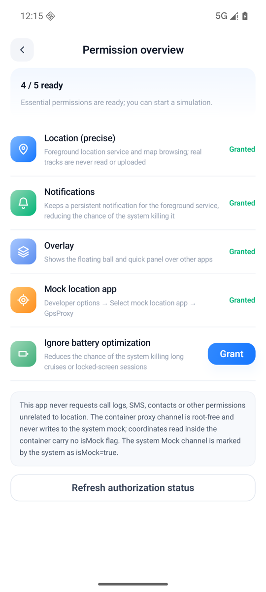
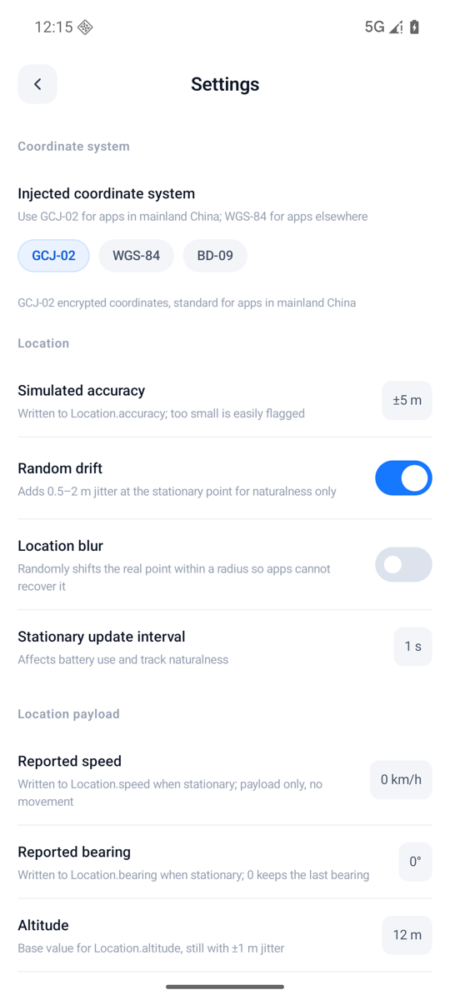
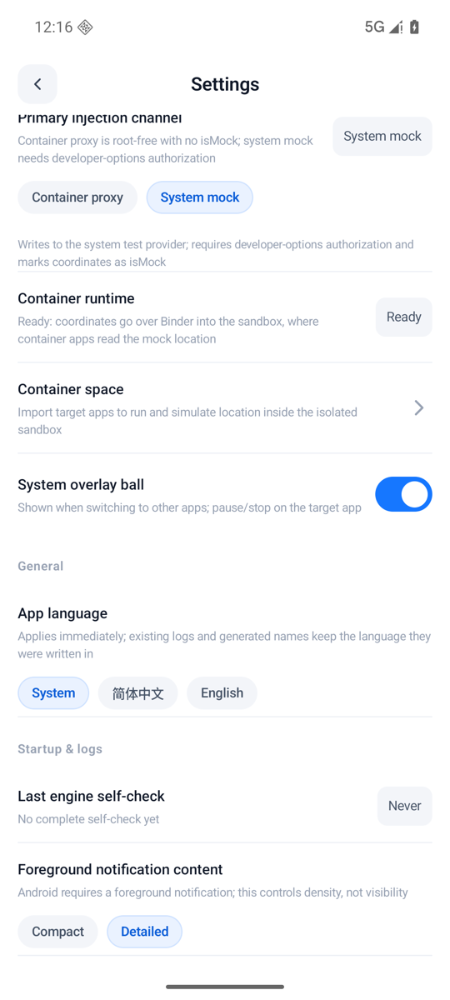

# GpsProxy

**English** | [简体中文](README.md)

An Android location simulation tool for developers and **authorized testing scenarios**. It injects mock coordinates into target apps through a virtual container proxy or the system test provider, and supports map picking, route cruising, and real road-network routing — no root required.

> For your own apps or authorized testing only. You are responsible for any consequences of using this tool for attendance spoofing, location fraud, or similar purposes.

## Screenshots

> Captured on an Android 16 (API 36) arm64 emulator.

<table>
  <tr>
    <td align="center"><b>Home · Map picking</b><br></td>
    <td align="center"><b>Pick coordinates · Reverse geocoding</b><br></td>
  </tr>
  <tr>
    <td align="center"><b>Route config · Waypoints / speed</b><br></td>
    <td align="center"><b>Cruising · Progress / reverse / speed</b><br></td>
  </tr>
  <tr>
    <td align="center"><b>Target apps · Import to sandbox</b><br></td>
    <td align="center"><b>Permissions · 5 capabilities</b><br></td>
  </tr>
  <tr>
    <td align="center"><b>Settings · Coordinates / accuracy / drift</b><br></td>
    <td align="center"><b>Injection channel · Container / System Mock</b><br></td>
  </tr>
</table>

## Features

### Location injection

| Channel | Scope | isMock | Prerequisites |
| --- | --- | --- | --- |
| **Container proxy** (default) | Only target apps imported into the sandbox | No | Import the app; host `targetSdk ≤ 28` |
| **System Mock** | All apps on the host | `isMock=true` | Grant "Mock location app" in Developer options |

- The container channel proxies `ILocationManager`'s `getLastLocation` / `getLastKnownLocation` / `getCurrentLocation` / `requestLocationUpdates`, calling back at the interval registered by the listener (the service clamps it to 200ms–5s).
- The System Mock channel writes through the official `addTestProvider` / `setTestProviderLocation`, and also syncs the satellite count and accuracy-breakdown fields in `Location.extras`.

### Routes and road network

- Four route sources: single point, two-point route (driving / cycling / walking), random roam, and GPX import. The UI labels the source honestly — built-in curves are never presented as real road network data.
- Waypoints (up to 8), loop / round trip, 0.25×–8× speed, progress seeking, reverse cruising, and joystick fine-tuning.
- With an AMap "Web Service" Key configured, real route planning is used; without a Key, network, or remaining quota, it falls back to built-in Bézier curves and shows the degradation reason on the cruising screen.

### Other

- Location fuzzing (random offset within a radius to prevent real-point inference), stationary drift, and adjustable accuracy / altitude / bearing / speed.
- Per-app activation, restore on boot, foreground-service persistent notification, and a floating-ball quick panel.
- Chinese/English i18n, diagnostic export, and engine self-check.

## Architecture

```text
UI (Compose) → ViewModel → UseCase → SimulationEngine
                                       ├─ RouteSource
                                       │    ├─ AmapRouteSource (real road network, requires Key)
                                       │    ├─ SyntheticRouteSource (built-in curves)
                                       │    ├─ RoamPlanner (random roam)
                                       │    └─ GPX import
                                       ├─ InjectionStrategy
                                       │    ├─ ContainerInjectionStrategy → Binder → BLocationManagerService → sandboxed app
                                       │    └─ OfficialMockInjectionStrategy → LocationManager.addTestProvider
                                       └─ Session state machine / progressor / location fuzzing
```

`SimulationEngine` produces one `LocationSample` per frame, and each strategy translates it into the platform objects for its channel. A channel that fails 3 times terminates the session, so no untrustworthy coordinates are produced.

## Modules

| Module | Description |
| --- | --- |
| `app` | Compose UI, domain layer, simulation engine, both injection channels, and platform adapters |
| `Bcore` | Android virtualization container derived from BlackBox (Binder / reflection hooks) |
| `black-reflection` | Runtime reflection binding (`@BClassName` / `@BMethod` annotation parsing) |
| `compiler` | Annotation processor that generates `BR*` factories for reflection interfaces |
| `locustest` | Location assertion harness for verifying injection results inside the container or on the host |

## Requirements

- Android 8.1 (API 27) or later; `arm64-v8a` / `armeabi-v7a`
- The System Mock channel requires granting GpsProxy in "Developer options → Select mock location app"
- Build: JDK 17, Android SDK (`compileSdk = 36`)
- Optional: AMap "Web Service" type Key (for real POIs and route planning)

## Build

```bash
# Write your local SDK path into local.properties (this file is gitignored — do not commit it)
echo "sdk.dir=$HOME/Library/Android/sdk" > local.properties

# Optional: real road network and POIs
# echo "amap.web.key=your-web-service-key" >> local.properties

./gradlew :app:assembleDebug
./gradlew :locustest:assembleDebug
./gradlew :app:testDebugUnitTest
```

Output: `app/build/outputs/apk/debug/app-debug.apk`.

## Verification

Unit tests cover coordinate-system conversion, route progress, the session state machine, channel strategies, and AMap response parsing (JVM, no device needed):

```bash
./gradlew :app:testDebugUnitTest
```

On-device verification (install `locustest` first, then import and start simulation in GpsProxy):

```bash
adb shell am start -n com.gpsproxy.locustest/.LocusActivity \
  --ed lat 30.250213 --ed lng 120.148832 --ed tol 15 --el interval 1000
adb logcat -s LocusTest | grep LOCUS_VERDICT
```

`LOCUS_VERDICT` prints a single-line JSON verdict asserting coordinate tolerance, accuracy, timestamp monotonicity, provider, and callback cadence (matching the container service's 200ms–5s clamp).

## Known limitations

- The container channel provides no `GnssStatus` callbacks, NMEA, or `GnssMeasurement`; satellite count is only exposed via `Location.extras["satellites"]`.
- Real road-network routing depends on an AMap Key; without one, all two-point routes are built-in synthetic curves (the UI labels them as "built-in curve").
- Coordinates from the System Mock channel carry `isMock=true`; this implementation does not hide that flag.
- Container compatibility requires host `targetSdk ≤ 28`, a constraint of the BlackBox engine.
- On some emulators/ROMs the container `:black` process may fail to become ready; switch to the System Mock channel in that case.

## License

[Apache License 2.0](LICENSE). `Bcore` is derived from [BlackBox](https://github.com/niunaijun/BlackBox), also licensed under Apache 2.0.
