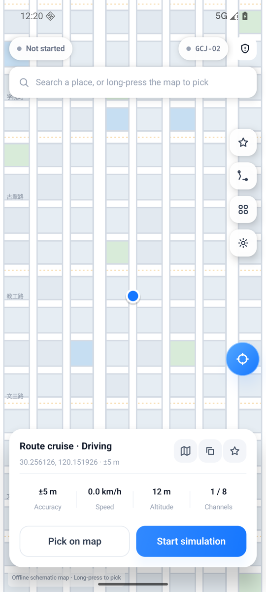
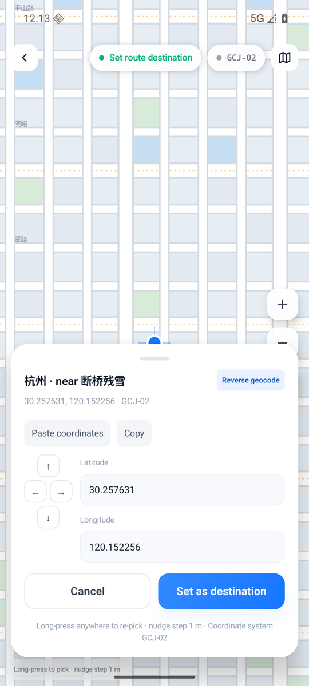
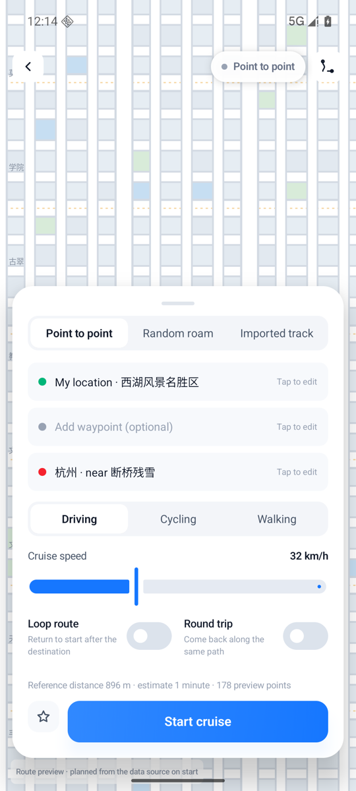
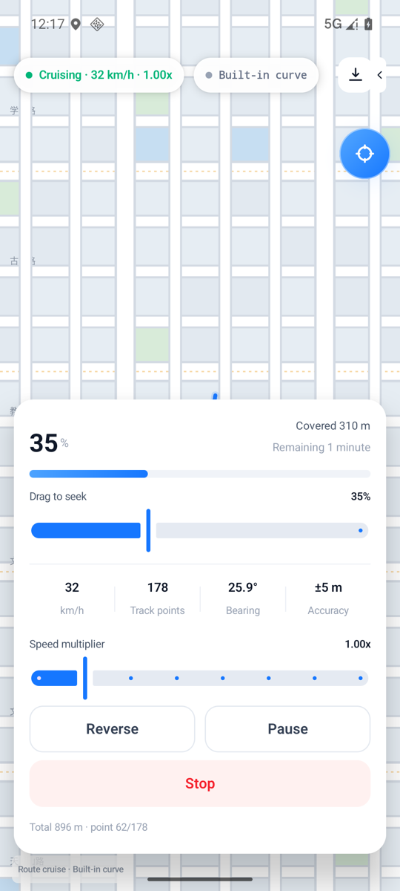
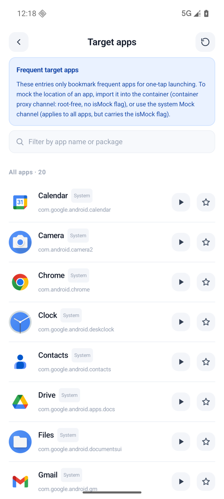
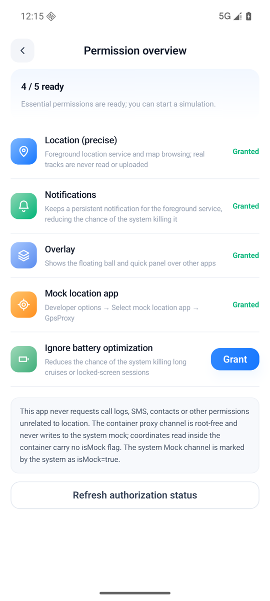
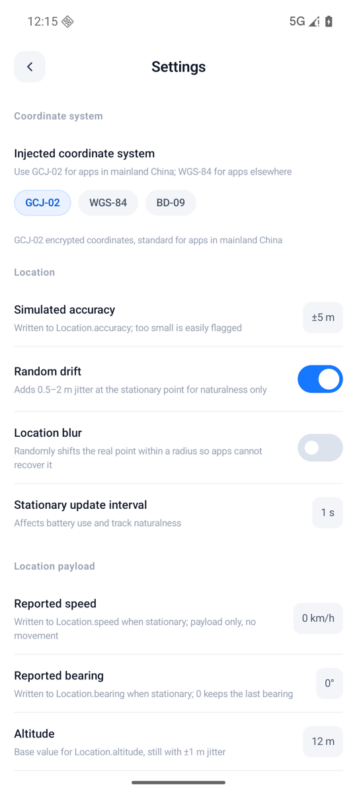
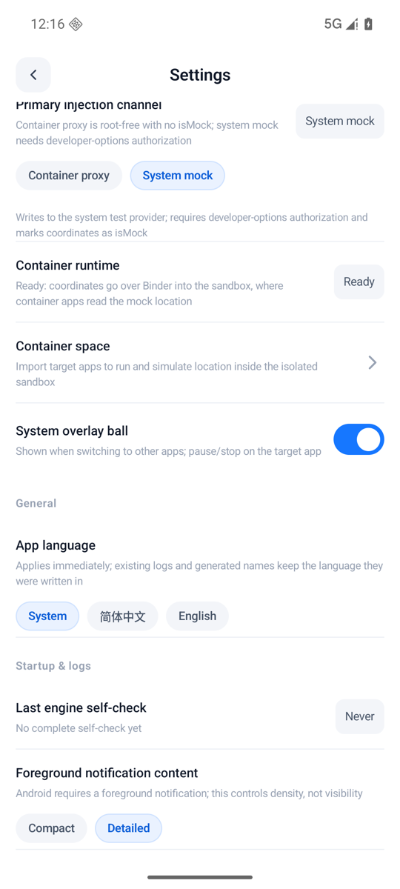

# GpsProxy

**简体中文** | [English](README.en.md)

Android 定位模拟工具，面向开发者与**已获得授权的测试场景**。通过虚拟容器代理或系统测试提供者向目标应用注入模拟坐标，支持地图选点、轨迹巡航与真实路网规划，免 root。

> 仅用于自有 App 或已获得授权的测试场景。将本工具用于考勤打卡、位置欺诈等场景的后果由使用者自行承担。

## 截图

> 以下为 Android 16（API 36）arm64 模拟器上的实际运行截图。

<table>
  <tr>
    <td align="center"><b>首页 · 地图选点</b><br></td>
    <td align="center"><b>坐标选择 · 逆地理编码</b><br></td>
  </tr>
  <tr>
    <td align="center"><b>轨迹配置 · 途经点 / 倍速</b><br></td>
    <td align="center"><b>巡航运行 · 进度 / 反向 / 倍速</b><br></td>
  </tr>
  <tr>
    <td align="center"><b>目标应用 · 导入沙箱</b><br></td>
    <td align="center"><b>权限总览 · 5 项能力</b><br></td>
  </tr>
  <tr>
    <td align="center"><b>设置 · 坐标 / 精度 / 漂移</b><br></td>
    <td align="center"><b>注入通道 · 容器 / 系统 Mock</b><br></td>
  </tr>
</table>

## 功能

### 定位注入

| 通道 | 作用范围 | isMock | 前置条件 |
| --- | --- | --- | --- |
| **容器代理**（默认） | 仅导入沙箱的目标应用 | 无 | 导入应用；宿主 `targetSdk ≤ 28` |
| **系统 Mock** | 宿主全部应用 | `isMock=true` | 开发者选项授予「模拟位置信息应用」 |

- 容器通道代理 `ILocationManager` 的 `getLastLocation` / `getLastKnownLocation` / `getCurrentLocation` / `requestLocationUpdates`，按监听登记的间隔回调（服务端钳制 200ms–5s）。
- 系统 Mock 通道通过官方 `addTestProvider` / `setTestProviderLocation` 写入，并同步 `Location.extras` 卫星数与精度细分字段。

### 轨迹与路网

- 四种轨迹来源：单点、两点路线（驾车 / 骑行 / 步行）、随机漫游、导入 GPX；界面如实标注来源，不把内置曲线伪装成路网。
- 途经点（最多 8 个）、循环 / 往返、0.25×–8× 倍速、进度跳转、反向巡航、摇杆微调。
- 配置高德「Web 服务」Key 后调用真实路径规划；无 Key / 无网络 / 配额耗尽时回退内置贝塞尔曲线，并在巡航页显示降级原因。

### 其他

- 位置模糊（在半径内随机平移，避免被反推真实点）、静止漂移、精度 / 海拔 / 航向 / 速度可调。
- 按应用生效、开机恢复、前台服务常驻通知、悬浮球快捷面板。
- 中英文 i18n、诊断导出与引擎自检。

## 架构

```text
UI (Compose) → ViewModel → UseCase → SimulationEngine
                                       ├─ RouteSource
                                       │    ├─ AmapRouteSource（真实路网，需 Key）
                                       │    ├─ SyntheticRouteSource（内置曲线）
                                       │    ├─ RoamPlanner（随机漫游）
                                       │    └─ 导入 GPX
                                       ├─ InjectionStrategy
                                       │    ├─ ContainerInjectionStrategy → Binder → BLocationManagerService → 沙箱应用
                                       │    └─ OfficialMockInjectionStrategy → LocationManager.addTestProvider
                                       └─ 会话状态机 / 进度器 / 位置模糊
```

`SimulationEngine` 每帧产出一份 `LocationSample`，由策略翻译成各通道的平台对象；通道失败 3 次即终止会话，避免产出不可信坐标。

## 模块

| 模块 | 说明 |
| --- | --- |
| `app` | Compose UI、领域层、模拟引擎、两条注入通道与平台适配 |
| `Bcore` | BlackBox 派生的 Android 虚拟化容器（Binder / 反射 Hook） |
| `black-reflection` | 运行时反射绑定（`@BClassName` / `@BMethod` 注解解析） |
| `compiler` | 注解处理器，为反射接口生成 `BR*` 工厂 |
| `locustest` | 定位断言替身，用于在容器或宿主内验证注入结果 |

## 环境要求

- Android 8.1（API 27）及以上；`arm64-v8a` / `armeabi-v7a`
- 系统 Mock 通道需在「开发者选项 → 选择模拟位置信息应用」中授权 GpsProxy
- 构建：JDK 17、Android SDK（`compileSdk = 36`）
- 可选：高德「Web 服务」类型 Key（用于真实 POI 与路径规划）

## 构建

```bash
# local.properties 写入本机 SDK 路径（该文件已被 .gitignore 排除，请勿提交）
echo "sdk.dir=$HOME/Library/Android/sdk" > local.properties

# 可选：真实路网与 POI
# echo "amap.web.key=你的Web服务Key" >> local.properties

./gradlew :app:assembleDebug
./gradlew :locustest:assembleDebug
./gradlew :app:testDebugUnitTest
```

产物：`app/build/outputs/apk/debug/app-debug.apk`。

### Release

```bash
./gradlew :app:assembleRelease
```

产物：`app/build/outputs/apk/release/app-release.apk`。Release 使用仓库内置的 `keystore/gpsproxy-release.jks` 签名（别名与口令均为 `gpsproxy`），密钥公开且不保密，任何人都可直接安装并覆盖升级。

CI：`.github/workflows/android-release.yml` 在推送到 `main`、推送 `v*` 标签或手动触发时构建 Release APK。版本号由 tag 推导：`v1.2.3` → `versionName=1.2.3`、`versionCode=1002003`；非 tag 构建使用最近 tag 加 `-snapshot.<sha>` 后缀。普通构建作为 Actions artifact 上传（保留 30 天）；推送 `v*` 标签会额外创建 GitHub Release 并附加 APK。可选：在仓库 Secrets 中配置 `AMAP_WEB_KEY` 以注入高德 Key。

## 验证

单元测试覆盖坐标系转换、轨迹进度、会话状态机、通道策略与高德响应解析（JVM，无需设备）：

```bash
./gradlew :app:testDebugUnitTest
```

实机验证（先安装 `locustest`，在 GpsProxy 中导入并启动模拟）：

```bash
adb shell am start -n com.gpsproxy.locustest/.LocusActivity \
  --ed lat 30.250213 --ed lng 120.148832 --ed tol 15 --el interval 1000
adb logcat -s LocusTest | grep LOCUS_VERDICT
```

`LOCUS_VERDICT` 会输出一行 JSON 结论，断言坐标容差、精度、时间戳单调性、提供者与回调节奏（对齐容器服务的 200ms–5s 钳制区间）。

## 已知限制

- 容器通道不提供 `GnssStatus` 回调，也没有 NMEA / `GnssMeasurement`；卫星数仅通过 `Location.extras["satellites"]` 传出。
- 真实路网依赖高德 Key；未配置时所有两点路线均为内置合成曲线（界面会标注为「内置曲线」）。
- 系统 Mock 通道的坐标带 `isMock=true`，本实现不隐藏该标记。
- 容器兼容性要求宿主 `targetSdk ≤ 28`，这是 BlackBox 引擎的约束。
- 部分模拟器/ROM 上容器 `:black` 进程无法就绪，此时请切换到系统 Mock 通道。

## 许可

[Apache License 2.0](LICENSE)。`Bcore` 派生自 [BlackBox](https://github.com/niunaijun/BlackBox)，同样以 Apache 2.0 授权。
